# AI Library

A browsable library of pose and costume references, with a rigged 3D mannequin for every pose.

- **288 poses**, each drawn from five angles: front, above, below, side and diagonal.
- **1,407 costumes** across eight categories, searchable by colour, garment, fabric and accessory.
- **A rigged 3D model for every pose**, shown side by side with its drawing, ready to adjust and
  download as `.glb` or `.bvh`.

Built with Next.js 16, React 19, Tailwind CSS 4, shadcn/ui and three.js.

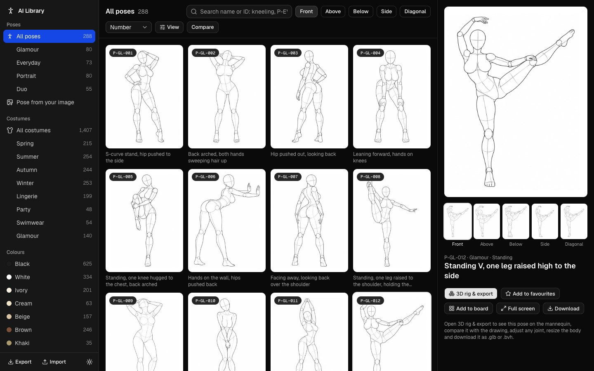

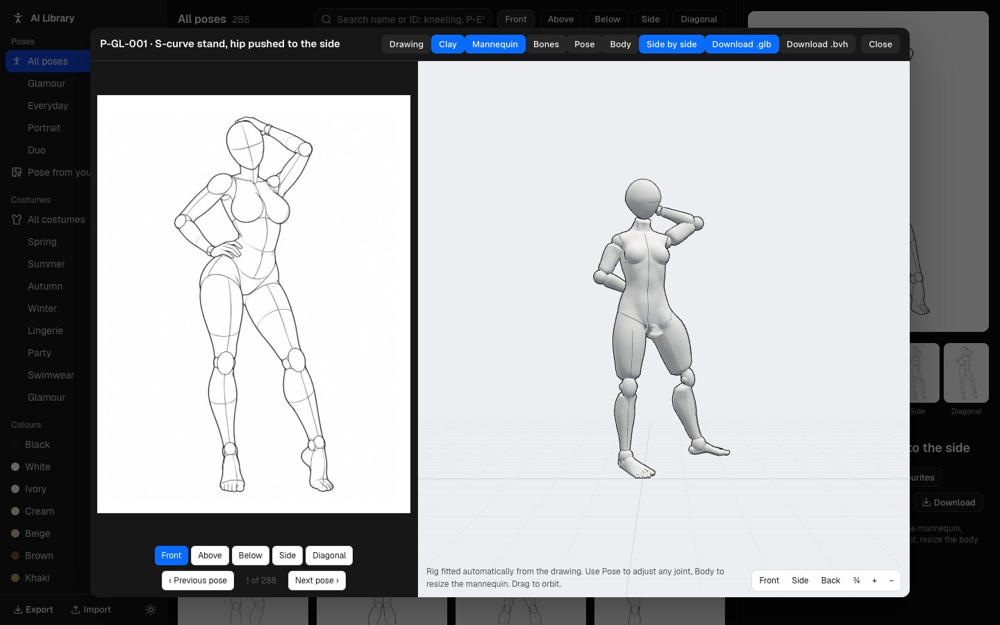

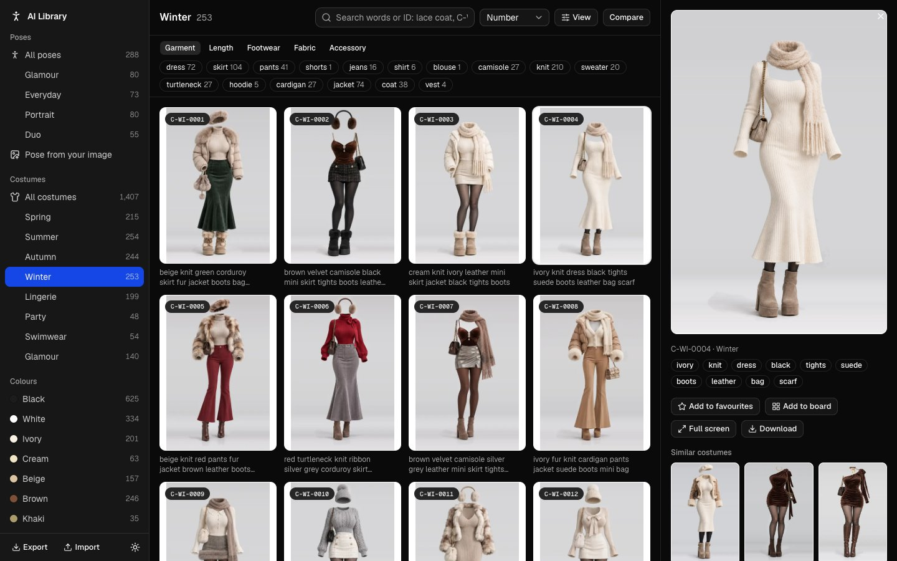

## Sample references

Every pose is drawn from five angles. P-GL-001, *S-curve stand, hip pushed to the side*:

| Front | Above | Below | Side | Diagonal |
| :---: | :---: | :---: | :---: | :---: |
| 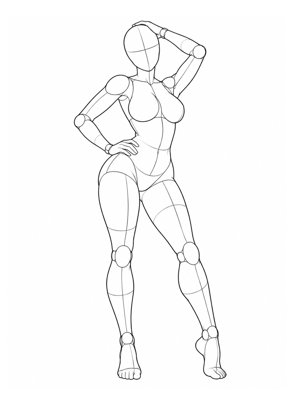 | 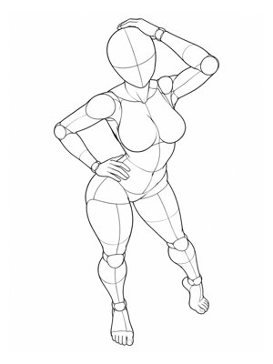 | 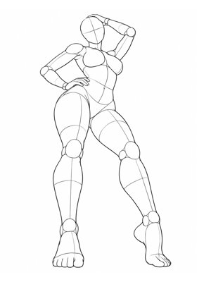 | 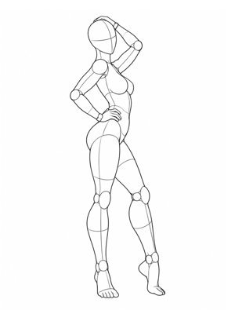 | 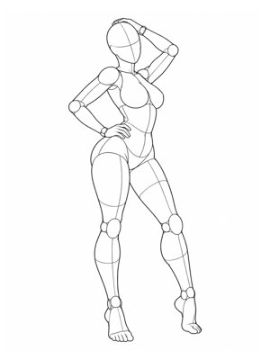 |

One costume from each season:

| Spring · C-SP-0001 | Summer · C-SU-0001 | Autumn · C-AU-0001 | Winter · C-WI-0004 |
| :---: | :---: | :---: | :---: |
| 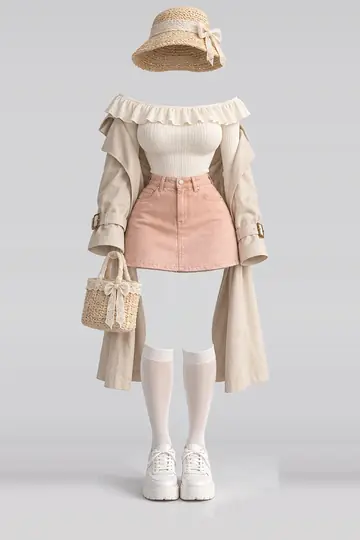 | 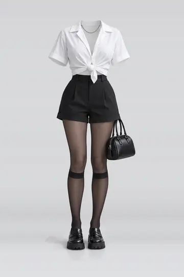 | 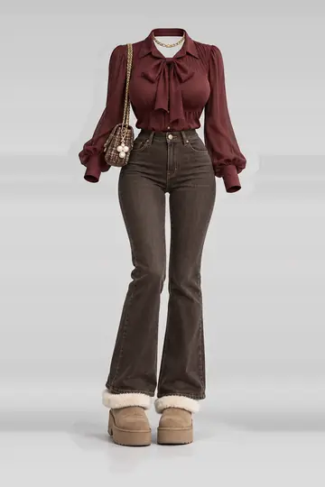 | 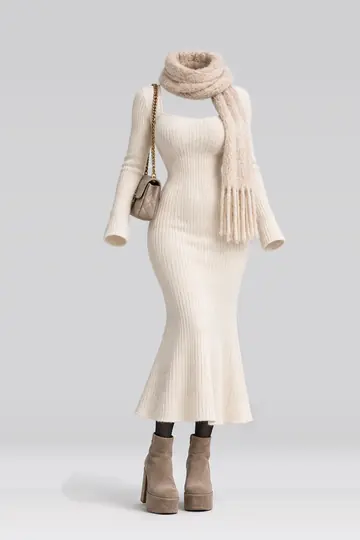 |

## Getting started

```bash
pnpm install
pnpm dev
```

Open http://localhost:3010. Everything the app needs ships in the repository, so there is nothing
to download or configure first.

## The images

All images are in `public/media` and are served as static files:

| Folder | Contents |
| --- | --- |
| `public/media/poses/thumbs` | 1,439 pose thumbnails (JPEG) |
| `public/media/poses/full` | 1,439 full-size pose drawings, 900 × 1200 (WebP) |
| `public/media/costumes/thumbs` | 1,407 costume thumbnails (WebP) |
| `public/media/costumes/img` | 1,407 costume images (WebP) |

Every image can also be downloaded from its detail panel in the app.

To serve the images from your own storage or CDN instead, upload the `public/media` folder as it is
and set the base URL before building:

```bash
NEXT_PUBLIC_MEDIA_BASE_URL=https://your-bucket.example.com pnpm build
```

## Getting the rigged model

1. Open any pose and choose **3D rig & export**.
2. Compare the mannequin with the drawing using **Side by side** and the angle tabs.
3. Optionally adjust joints with **Pose** and the body shape with **Body**, then **Save pose to library**.
4. Choose **Download .glb** for a rigged, posed mesh, or **Download .bvh** for the skeleton alone.

The model uses a 17-bone skeleton (pelvis, spine, chest, neck, head, upper arms, forearms, hands,
thighs, shins and feet), which imports into Blender and any tool that reads glTF or BVH.

The fitted rig for a pose is also available as JSON:

```
GET /api/fits/:code        e.g. /api/fits/P-GL-001
```

It returns the bone rotations, the camera angle of each drawing and the measured body proportions.

**Pose from your image** puts the pose from any photo or drawing onto the mannequin. The image is
read in the browser and never uploaded.

## Features

- Filter poses by group and class, and costumes by category, colour and keyword.
- Search, sort and shuffle; every view is a shareable URL.
- Favourites, recently viewed, saved rigs and boards for collecting one character's references.
- Compare up to four items, full-screen zoom, and image adjustments (mirror, invert, contrast, tint).
- Export and import your favourites, boards and saved rigs as JSON.
- Dark and light themes; works on phones, tablets and desktops.

## Project structure

```
data/                      pose and costume catalogue, and the joint data the rigs are fitted from
docs/screenshots/          the screenshots in this README
public/media/              pose and costume images
public/assets/             the base mannequin body (glTF)
src/app/(library)/         poses, costumes, collections, boards and pose-from-image screens
src/app/api/fits/          fits the rig for one pose
src/components/library/    shell, sidebar, grid, inspector and dialogs
src/components/ui/         shadcn/ui primitives
src/hooks/client/          library state, URL state and the 3D viewer launcher
src/lib/                   catalogue, saved library state, rig fitting and the 3D viewer
```

## Licence

The source code is released under the [MIT License](LICENSE). The base mannequin body in
`public/assets` is CC0; see `public/assets/base-female-LICENSE.txt`.
